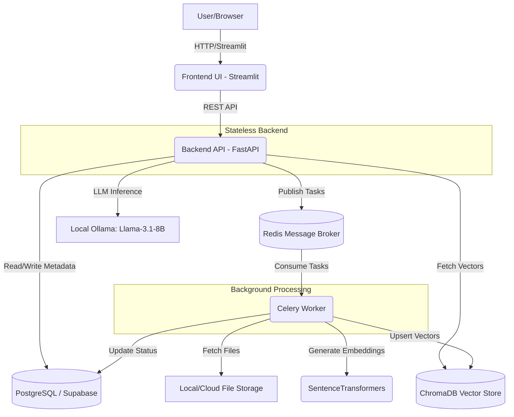

# Corpus AI - Enterprise Document Q&A 🧠

Corpus AI is a multi-tenant, Retrieval-Augmented Generation (RAG) assistant designed for enterprise environments. It allows employees to upload company documents securely and ask natural language questions, retrieving answers strictly from their organization's internal data with full source citations.

## 🌟 Key Features
- **Multi-tenant Architecture**: Strict row-level and application-level filtering ensures Company A can never access Company B's data.
- **RAG Pipeline**: Uploads (PDF, DOCX, TXT) are automatically parsed, chunked, and vectorized using asynchronous background workers.
- **Verifiable Answers**: The LLM provides direct citations back to the source document chunks used to generate the answer.
- **Enterprise Controls**: Admin dashboards, usage tracking, and rate limiting (using Redis).

## 🏗️ System Architecture

Corpus AI employs a decoupled, highly scalable architecture suitable for enterprise deployment:



### Architecture Design Decisions (System Design Context)
1. **Stateless API Layer (FastAPI)**: By keeping the API stateless, we can horizontally scale the backend behind a load balancer without worrying about sticky sessions. All state lives in Postgres, Redis, or Chroma.
2. **Asynchronous Processing (Celery + Redis)**: Document chunking and embedding are CPU/Memory intensive. If done synchronously in the API request, it would cause timeouts and degrade user experience. Offloading to Celery workers ensures the API remains highly responsive.
3. **Caching & Rate Limiting (Redis)**: Redis acts as a fast, in-memory datastore. We use it not only as a message broker for Celery, but also to rate-limit users (e.g., 20 queries/hour) to control LLM costs.
4. **Vector Database (ChromaDB)**: We store dense vector embeddings separate from our relational data because performing cosine-similarity searches on 100k+ chunks requires specialized indexing (HNSW) that traditional SQL databases are not optimized for by default.

## 🚀 Tech Stack
- **Backend Framework**: Python, FastAPI
- **Frontend**: Streamlit
- **Relational DB**: Supabase (PostgreSQL), SQLAlchemy
- **Vector DB**: ChromaDB
- **Caching & Queues**: Redis, Celery
- **Embeddings**: `sentence-transformers/all-MiniLM-L6-v2`
- **LLM**: Local Ollama (Llama-3.1-8B)

## 💻 Local Development Setup

*Requires 8GB+ RAM to run local LLMs and Embeddings.*

1. **Clone & Virtual Environment**
   ```bash
   git clone <repo-url>
   cd companybrain
   python -m venv venv
   source venv/bin/activate  # On Windows: venv\Scripts\activate
   pip install -r requirements.txt
   ```

2. **Environment Variables**
   Create a `.env` file based on `.env.example` and fill in your Supabase keys.

3. **Start Services**
   You will need 4 separate terminal windows to run all components locally:

   **Terminal 1 (Ollama):**
   ```bash
   ollama run llama3.1
   ```
   **Terminal 2 (Redis):**
   ```bash
   redis-server
   ```
   **Terminal 3 (FastAPI & Celery):**
   ```bash
   uvicorn app.main:app --reload
   celery -A app.worker.celery_app worker --loglevel=info
   ```
   **Terminal 4 (Streamlit Frontend):**
   ```bash
   streamlit run frontend/app.py
   ```
