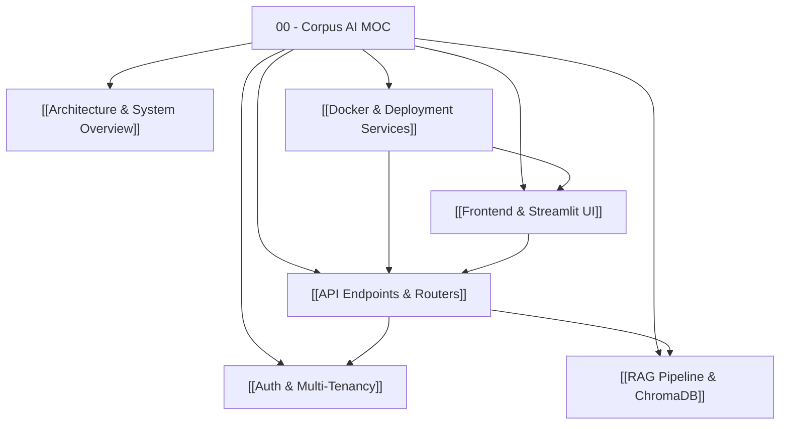

# 🗺️ Corpus AI — Map of Content (MOC)

#moc #corpus-ai #architecture

Welcome to the **Corpus AI Obsidian Knowledge Graph**. This vault serves as the persistent, single source of truth for the entire architecture, container infrastructure, API endpoints, RAG pipeline, and frontend routing of Corpus AI.

> [!TIP]
> **To AI Assistants / Developers**: Instead of scanning or grepping the codebase repeatedly, consult this Map of Content and its linked notes first for complete context on any subsystem.

---

## 📌 Core Knowledge Graph

---

## 📂 Subsystem Index

| Note | Focus Area | Tags | Key Files |
| :--- | :--- | :--- | :--- |
| **[[Architecture & System Overview]]** | High-level system design, multi-tenant isolation, stack decisions | `#system` `#overview` | `app/main.py`, `app/config.py`, `app/db.py` |
| **[[Docker & Deployment Services]]** | Compose services (api, worker, frontend, redis), networking & ports | `#docker` `#deployment` | `docker-compose.yml`, `Dockerfile`, `frontend.Dockerfile` |
| **[[Auth & Multi-Tenancy]]** | JWT authentication, role guards (Admin/Member), tenant isolation | `#auth` `#security` | `app/auth.py`, `app/routers/auth_router.py`, `app/models.py` |
| **[[RAG Pipeline & ChromaDB]]** | Document ingestion, chunking, embeddings, Chroma vector store, Ollama | `#rag` `#ai` `#chromadb` | `app/services/vector_store.py`, `app/worker.py`, `app/routers/chat_router.py` |
| **[[API Endpoints & Routers]]** | All FastAPI endpoints (`/auth`, `/documents`, `/chat`, `/dashboard`, `/health`) | `#backend` `#fastapi` | `app/routers/*.py`, `app/schemas.py` |
| **[[Frontend & Streamlit UI]]** | Multi-page Streamlit portal, dynamic navigation, API client wrapper | `#frontend` `#streamlit` | `frontend/app.py`, `frontend/pages/`, `frontend/utils/api_client.py` |

---

## ⚡ Quick Operational Facts
- **Execution Mode**: Runs inside Docker via `docker compose up -d`
- **Frontend Port**: `http://localhost:8501` (Streamlit)
- **API Port**: `http://localhost:8000` (FastAPI Swagger at `/api/v1/docs`)
- **Worker**: Celery background queue processing uploads using Redis (`redis:6379/0`)
- **LLM/Embeddings**: Local Ollama at `http://host.docker.internal:11434` (`llama3.1:8b`) + `sentence-transformers/all-MiniLM-L6-v2`
- **Database**: SQLite mounted to volume `/app/data/corpus_ai.db` in dev, or PostgreSQL (Supabase) in prod.
