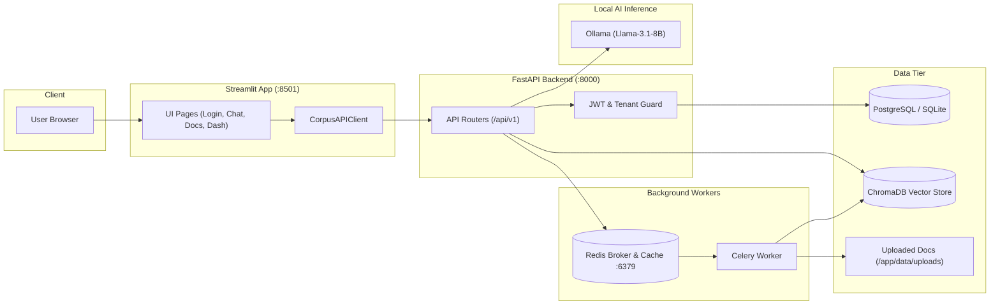

# 🏛️ Architecture & System Overview

#architecture #system #overview
Parent: [[00 - Corpus AI Map of Content (MOC)]]

Corpus AI is an enterprise document Q&A assistant built with multi-tenancy at its core. Multiple organizations (companies) share the same infrastructure while strictly isolating their data.

---

## 🏗️ High-Level Component Flow

---

## 🔑 Design Principles
1. **Stateless API**: All application state resides in PostgreSQL/SQLite, Redis, or ChromaDB. Multiple FastAPI instances can run behind a load balancer without sticky sessions.
2. **Multi-Tenancy Isolation**: Every document, user, invitation, chat session, and vector embedding is strictly tagged with `company_id`. No query ever executes across tenant boundaries.
3. **Asynchronous Ingestion**: File uploading immediately returns a `202 Accepted` with a task ID; chunking and embedding are handled by Celery workers so API endpoints stay sub-second.
4. **Resilient Token Management**: The frontend automatically intercepts HTTP 401 errors, requests a new access token via `/auth/refresh`, and transparently replays the request without logging the user out.

---

## 🔗 Related Notes
- [[Docker & Deployment Services]] — How these components run in containers
- [[Auth & Multi-Tenancy]] — Detailed security and company isolation
- [[RAG Pipeline & ChromaDB]] — Vector search and LLM context building
