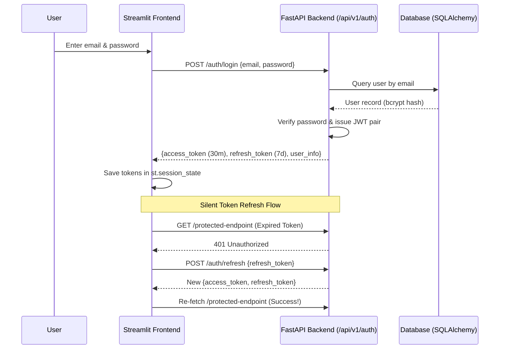

# 🔐 Auth & Multi-Tenancy

#auth #security #multitenancy #rbac
Parent: [[00 - Corpus AI Map of Content (MOC)]]

Corpus AI enforces strict tenant-level data isolation and role-based access control (RBAC).

---

## 🏢 Multi-Tenancy Model
- Every company is represented by a `Company` record in the database.
- Every `User`, `Document`, `DocumentChunk`, `Invite`, `ChatSession`, and `ChatMessage` has a mandatory foreign key to `company_id`.
- Vector embeddings in ChromaDB are tagged with metadata `{ "company_id": str(company_id) }`. All semantic searches include a `where={"company_id": str(company_id)}` filter.

---

## 🛡️ Authentication Architecture

---

## 👥 Role-Based Access Control (RBAC)
- **Roles**:
  - `admin` / `super_admin`: Full access to upload docs, manage users, invite team members, view company-wide cost & usage analytics.
  - `member`: Access to Chat Q&A and Document search within their company.
- **Route Protection**:
  - Backend: `@router.post("/invite", dependencies=[Depends(require_role("admin", "super_admin"))])`
  - Frontend: Streamlit `st.navigation` only mounts Dashboard & Settings if `role in ["admin", "super_admin"]`.
