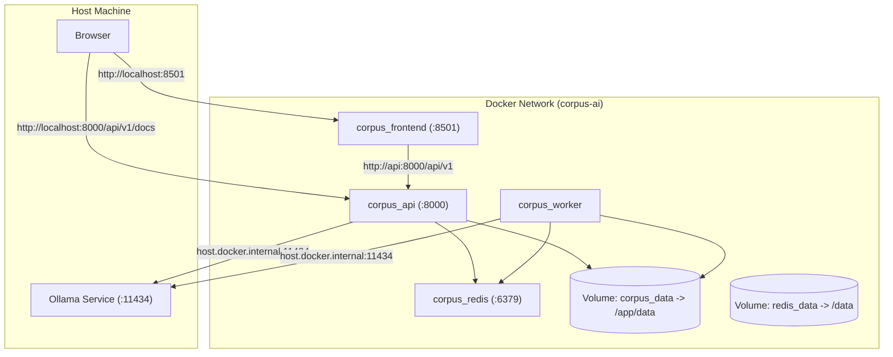

# 🐳 Docker & Deployment Services

#docker #deployment #containers #devops
Parent: [[00 - Corpus AI Map of Content (MOC)]]

The entire Corpus AI system is orchestrated via Docker Compose, eliminating host OS dependency issues (such as Python 3.13 / C-extension wheel mismatches).

---

## 📦 Services Topology

| Service | Container Name | Base Image / Dockerfile | Exposed Port | Purpose |
| :--- | :--- | :--- | :--- | :--- |
| `api` | `corpus_api` | `Dockerfile` (Python 3.11-slim) | `8000:8000` | FastAPI server (`uvicorn app.main:app`) |
| `frontend` | `corpus_frontend` | `frontend.Dockerfile` (Python 3.11-slim) | `8501:8501` | Streamlit multi-page interface |
| `worker` | `corpus_worker` | `Dockerfile` (Python 3.11-slim) | Internal | Celery worker for doc chunking & embedding |
| `redis` | `corpus_redis` | `redis:7-alpine` | `6379:6379` | Celery broker + query cache + rate limiter |

---

## 🌐 Networking & Volumes



---

## 🚀 Running the Project

### 1. Ensure Prerequisites
- **Docker Desktop**: Must be started and running.
- **Ollama**: (Optional for local inference) running on host at `http://localhost:11434`.

### 2. Start Containers (One-Command Launcher)
```bash
# Automatically boots containers, waits for health check, and opens browser:
.\start.bat
# or in PowerShell:
.\start.ps1
```

*(Alternative manual command: `docker compose up -d`)*

### 3. Stop Containers
```bash
.\stop.bat
```

### 3. Verify Container Status
```bash
docker compose ps
```

### 4. Access URLs
- **Web App UI**: [http://localhost:8501](http://localhost:8501)
- **Interactive API Docs (Swagger)**: [http://localhost:8000/api/v1/docs](http://localhost:8000/api/v1/docs)

### 5. Inspect Logs
```bash
# View backend logs
docker logs -f corpus_api

# View frontend logs
docker logs -f corpus_frontend

# View worker logs
docker logs -f corpus_worker
```
