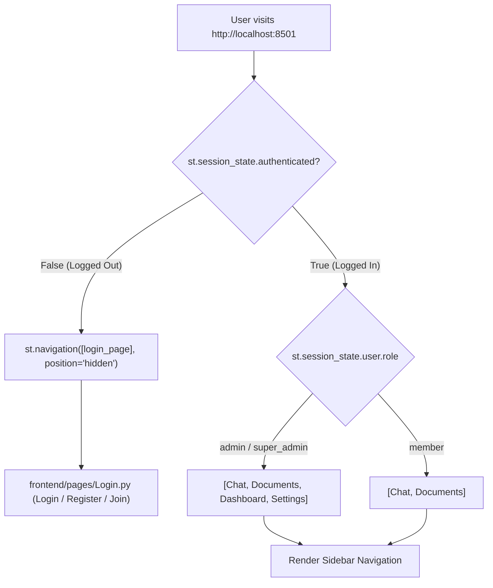

# 🖥️ Frontend & Streamlit UI

#frontend #streamlit #ui #routing
Parent: [[00 - Corpus AI Map of Content (MOC)]]

The frontend is built using Streamlit's programmatic navigation API (`st.navigation` & `st.Page`), offering a reactive multi-page web application.

---

## 🧭 Page Architecture & Dynamic Routing

---

## 📁 File Structure
- `frontend/app.py`: Entry point configuring programmatic navigation.
- `frontend/components/auth.py`: State initialization (`init_auth_state`) and login helpers.
- `frontend/utils/api_client.py`: `CorpusAPIClient` wrapper managing authorization headers, token refreshing, and JSON serialization.
- `frontend/pages/`:
  - `Login.py`: Tabbed authentication (Log in, Register organization, Join with code).
  - `Chat.py`: Interactive Q&A chat interface with streaming answers and document citations.
  - `Documents.py`: Document upload (drag & drop) and status monitoring table.
  - `Dashboard.py`: Plotly metrics for query volume, top questions, and storage.
  - `Settings.py`: Team member invites, role management, and API config.
