# 🧠 RAG Pipeline & ChromaDB

#rag #chromadb #embeddings #celery #ollama
Parent: [[00 - Corpus AI Map of Content (MOC)]]

The Retrieval-Augmented Generation (RAG) subsystem converts raw files (PDF, DOCX, TXT) into chunked vector embeddings, indexes them with ChromaDB, and performs context retrieval for the Ollama LLM.

---

## 🔄 Ingestion & Retrieval Pipeline

```mermaid
flowchart TD
    subgraph Ingestion["Document Ingestion (Asynchronous)"]
        Upload["Admin uploads document"] --> FastAPI["POST /api/v1/documents/upload"]
        FastAPI --> SaveFile["Save file to /app/data/uploads"]
        FastAPI --> TaskDispatch["Dispatch Celery task: process_document_task"]
        FastAPI -- "202 Accepted {doc_id, task_id}" --> UserResp["Return to user"]

        TaskDispatch --> Worker["Celery Worker"]
        Worker --> Extract["Extract Text (PyPDF2 / docx / txt)"]
        Extract --> Chunk["Chunk Text (RecursiveCharacterTextSplitter)"]
        Chunk --> Embed["Embed Chunks (sentence-transformers/all-MiniLM-L6-v2)"]
        Embed --> ChromaInsert["ChromaDB insert (with company_id metadata)"]
        ChromaInsert --> DBUpdate["Update Document status = 'ready'"]
    end

    subgraph QueryFlow["Query & Citation Flow"]
        Q["User Question"] --> ChatAPI["POST /api/v1/chat"]
        ChatAPI --> CheckCache{"Redis Cache Hit?"}
        CheckCache -- Yes --> ReturnCache["Return cached answer & citations"]
        CheckCache -- No --> Retrieve["ChromaDB.query(query, n_results=5, where={company_id})"]
        Retrieve --> Rerank["Rank Context Chunks"]
        Rerank --> Prompt["Construct Prompt with Context & Strict Citation Rules"]
        Prompt --> OllamaCall["Ollama API: llama3.1:8b (host.docker.internal:11434)"]
        OllamaCall --> StreamResp["Stream / return response with document citations"]
        StreamResp --> CacheStore["Store in Redis (TTL: 1 hour)"]
    end
```

---

## ⚙️ Key Technical Specifications
- **Embeddings**: `sentence-transformers/all-MiniLM-L6-v2` (384 dimensions, CPU-friendly).
- **Chunking Strategy**: `chunk_size=500`, `chunk_overlap=50` characters.
- **Vector Database**: `ChromaDB` persistent client at `/app/data/chroma`.
- **LLM**: Local `Ollama` running `llama3.1:8b` via `http://host.docker.internal:11434`.
- **Citation Guarantee**: If no relevant documents are retrieved above the similarity threshold, the model is prompted to explicitly state that the answer is not present in internal documentation.
